# Service Monitor

Watches Windows services and tells people when they **stop, crash, hang or stop answering** – by email (Gmail,
Yahoo Mail, iCloud Mail, any SMTP server), phone push (ntfy), Microsoft Teams, Slack, Discord, Telegram or a JSON
webhook.

Built for the situation where a vendor's service crashes or hangs on a customer server and then sits stopped with
nobody knowing. It runs as a small Windows service, restarts the service if you want it to, and sends the crash
details from the Windows event log along with the alert.

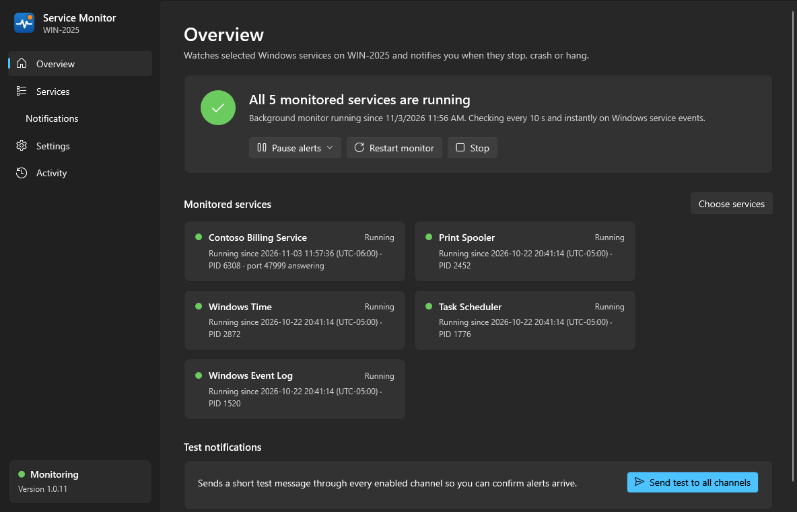

* **Download:** [Releases](https://github.com/dmajchrowski/ServiceMonitor/releases)
* **Setting it up on a server:** [docs/TECHNICIAN-GUIDE.md](docs/TECHNICIAN-GUIDE.md)
* **Optional, for IT:** [docs/OAUTH-APP-REGISTRATION.md](docs/OAUTH-APP-REGISTRATION.md) – only needed to offer
  *Sign in with Microsoft* (Outlook.com / Microsoft 365) or *Sign in with Google*. Gmail, Yahoo and iCloud work with
  app passwords and need nothing from IT.

## What it detects

| Situation | How it is detected | Alert |
|---|---|---|
| Service crashes | Polling (default every 10 s) **plus** a live subscription to Service Control Manager events 7031/7034, so detection is near-instant | *crashed*, with the Application Error / .NET Runtime event (exception and stack trace) attached |
| Service stops | Polling + SCM event 7036 | *stopped* / *stopped with an error* (Win32 or service-specific exit code decoded) |
| Start fails / times out | SCM events 7000, 7009, 7011, 7022 | *failed to start* |
| Hangs while starting or stopping | Stuck in a pending state longer than the threshold (default 120 s, per service) | *is hung* |
| Freezes while "Running" | Optional TCP port check per service (3 failures in a row) – the app can detect which port a service listens on | *is not responding on port …* |
| Crashes and is restarted by Windows' own recovery before anyone notices | SCM crash event for a service that is running again | warning *crashed and was restarted by Windows* |
| Service uninstalled / paused | Polling | *is no longer installed* / *is paused* |
| Still down | Reminder interval (default 60 min) | *STILL DOWN* |
| Back up | Polling | *RESOLVED* with downtime and who restarted it |

Also: optional **auto-restart** with back-off and a final "gave up" alert, a **startup grace period** after
reboots, **maintenance mode** (pause alerts), **flood protection** for flapping services, **monitor
started/stopped** notices (they tell you about reboots), an optional **daily/weekly heartbeat**, **retries** per
channel (30 s / 2 min / 10 min), and a **"channel needs attention"** notice through the other channels if a sign-in
expires. Important events also go to the Windows Application event log (source *Service Monitor*, IDs 100–302) for
RMM tools.

## What the alerts look like

Every alert names the site and computer, says what happened in plain words, and includes the details a technician
needs: exit code, process, executable and the matching Windows events. When the service is back, a **RESOLVED**
message says how long it was down and who restarted it.

<p>
  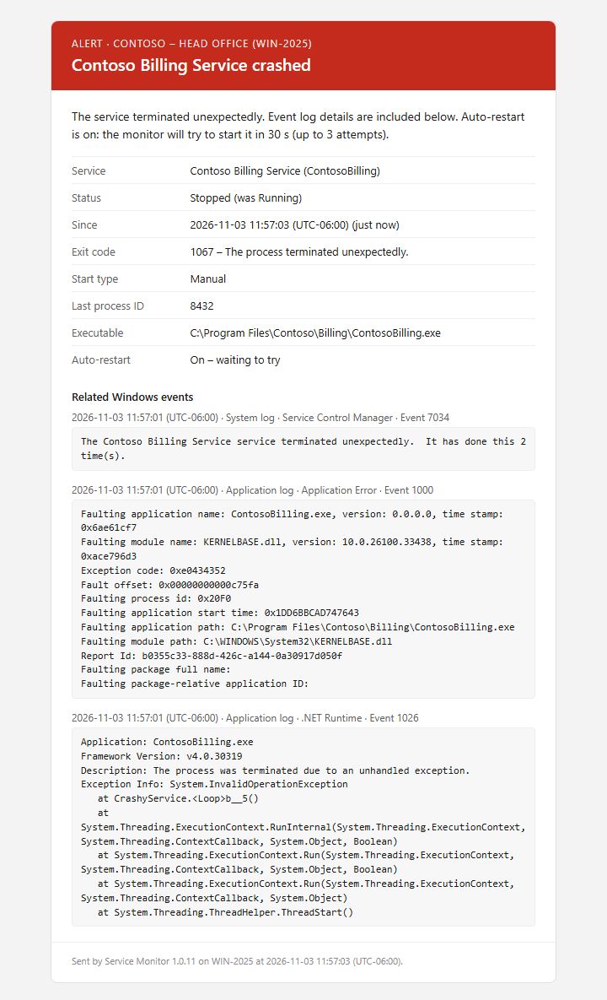
  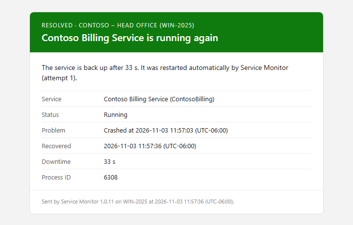
</p>

The same alert in Microsoft Teams, Slack, Discord, Telegram and the ntfy phone app:

<p>
  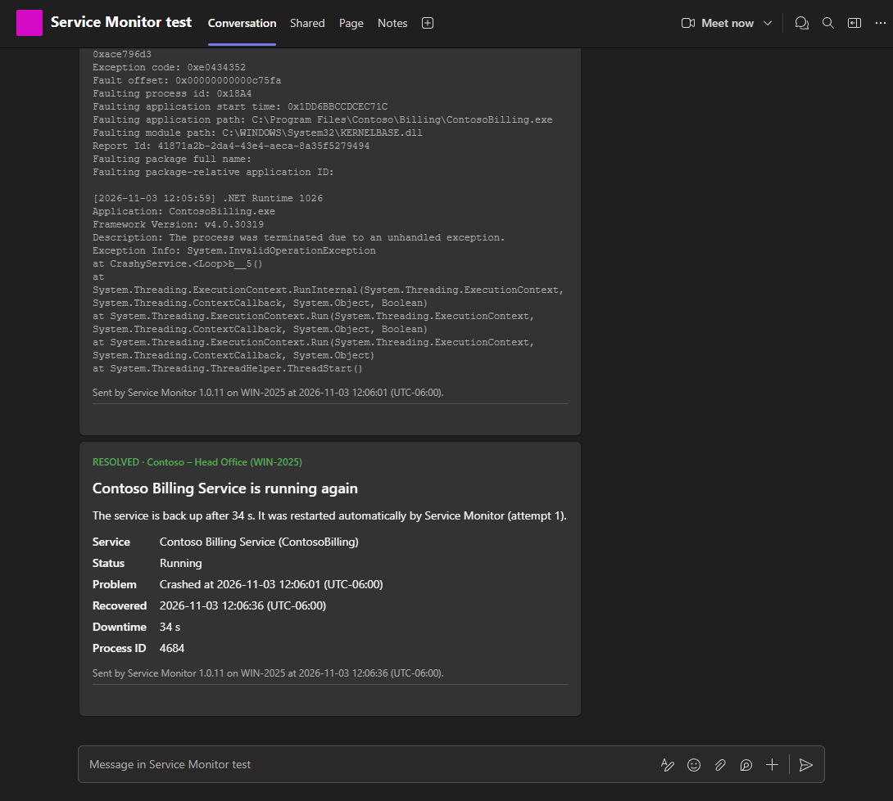
  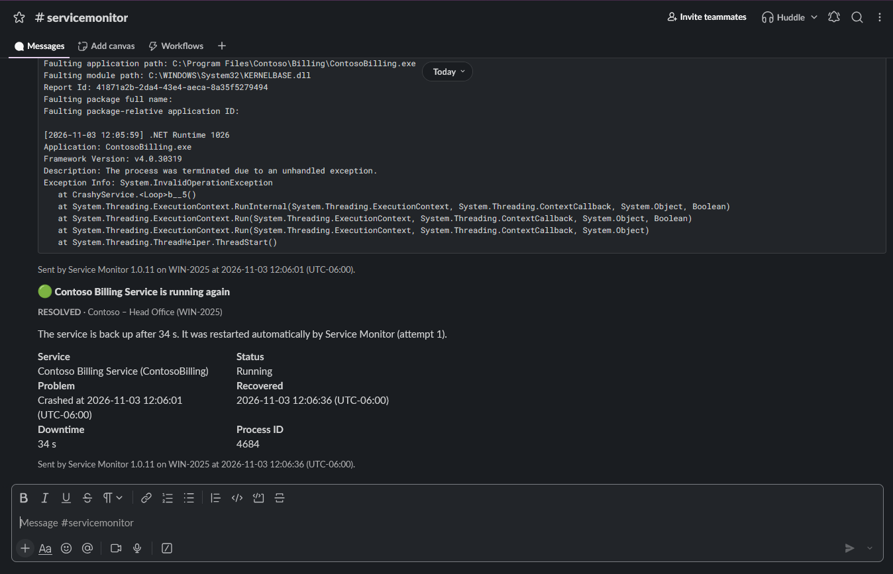
</p>
<p>
  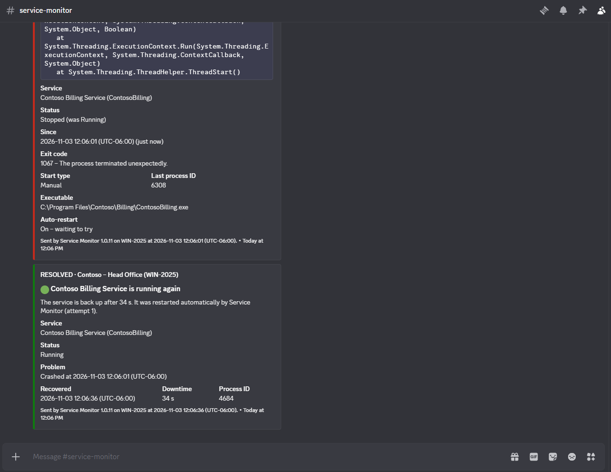
  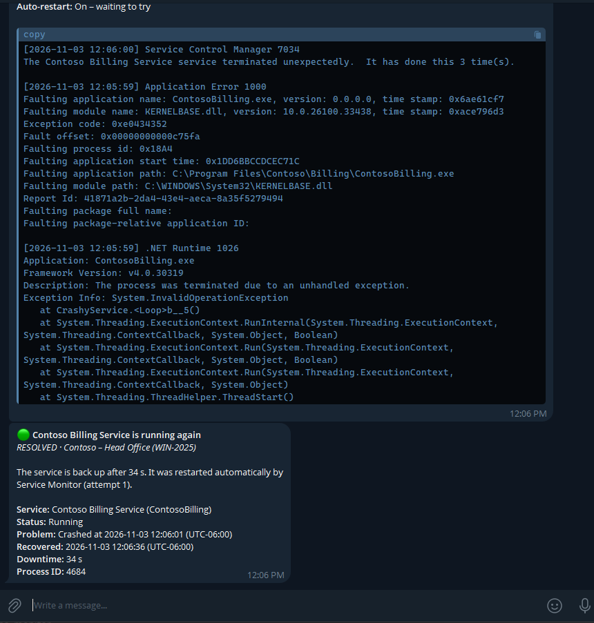
  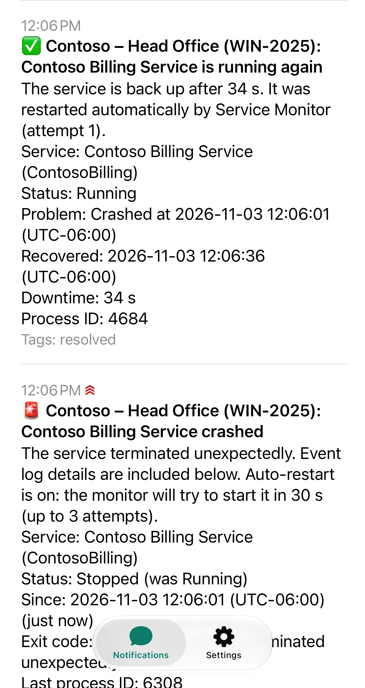
</p>

## Where alerts go

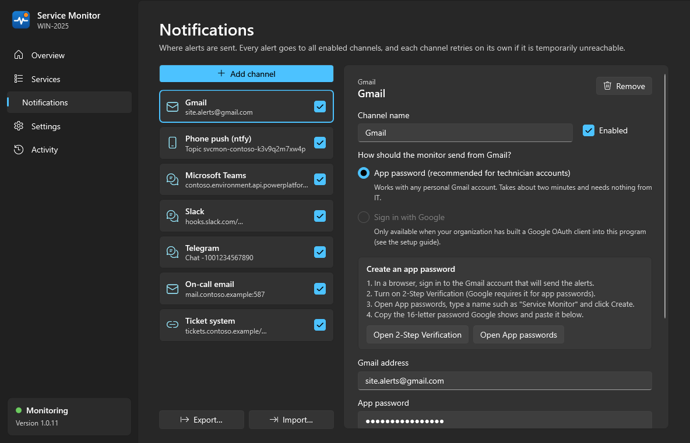

| Channel | How it sends |
|---|---|
| **Gmail** | App password over SMTP – nothing for IT to set up. Or *Sign in with Google* (Gmail API, `gmail.send`) if a Google OAuth client is built in. |
| **Yahoo Mail, iCloud Mail** | Presets with app passwords. |
| **Any SMTP server** | STARTTLS, SSL or plain, with or without sign-in. |
| **Outlook.com / Microsoft 365** | *Sign in with Microsoft* (Graph `sendMail`). Only offered once a Microsoft app registration is built in: Outlook.com no longer accepts passwords from other programs. |
| **Phone push (ntfy)** | Free push to Android and iPhone through ntfy.sh or your own ntfy server. Critical alerts break through *Do Not Disturb*. |
| **Microsoft Teams** | A Workflows webhook ("Send webhook alerts to a channel"). Adaptive Card with the details. |
| **Slack, Discord** | Incoming webhooks. |
| **Telegram** | A bot you create with @BotFather. |
| **Webhook** | A JSON `POST` to any URL – RMM/PSA tools, Power Automate, n8n, Zapier, on-call services. |

Each channel has **Send test**, and each channel editor shows the steps to get its app password, webhook URL or bot
token.

**Copy channels to another server.** **Export…** writes every channel, with its passwords and webhook URLs, to a
`.smchannels` file encrypted with a password you choose; **Import…** adds them on the other server.

<p>
  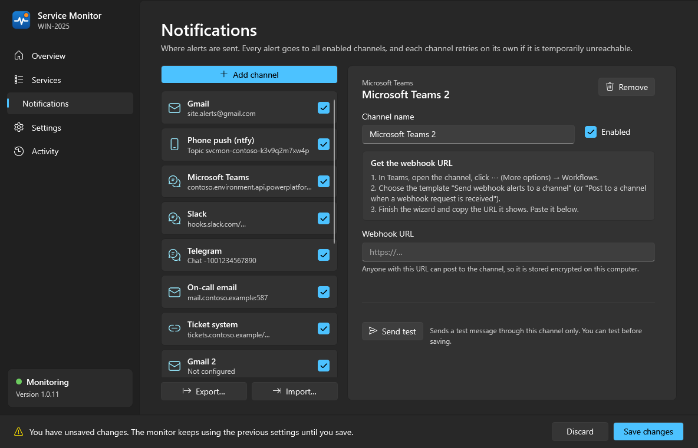
  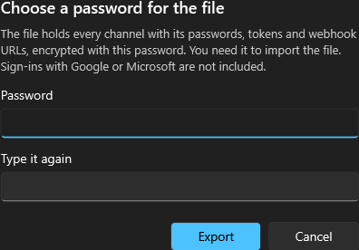
</p>

## Installing

Download `ServiceMonitor-Setup-<version>.exe` from [Releases](https://github.com/dmajchrowski/ServiceMonitor/releases)
and run it (it asks for administrator rights itself). The setup is not code-signed yet, so Windows SmartScreen warns
first: click **More info → Run anyway**. On PCs with Smart App Control turned on, Windows blocks it.

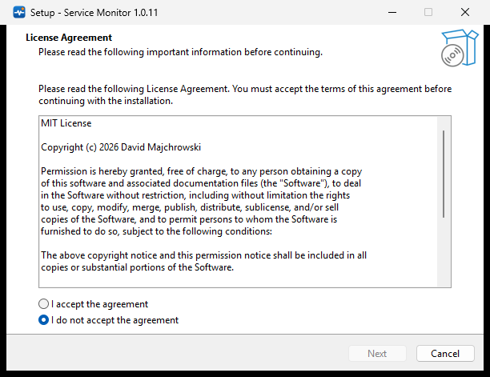

The setup first shows the [MIT License](LICENSE), which must be accepted. It then installs the program to
`C:\Program Files\Service Monitor`, a Start menu shortcut, an optional desktop shortcut and an uninstaller
(**Installed apps → Service Monitor**).

Then open **Service Monitor** and follow the four steps on its Overview page: choose the services, choose where alerts
go, send a test, and click **Install & start monitoring**. That installs the background monitor as the Windows service
**Service Monitor** (`ServiceMonitor`, automatic start, restarted by Windows if it ever fails). The
[technician guide](docs/TECHNICIAN-GUIDE.md) walks through it.

Running a newer setup updates in place: the monitor is stopped, updated and started again, and settings are kept.
Uninstalling removes the program, the service and the shortcuts, and asks whether to delete the settings too.

Silent install and uninstall (the uninstall keeps the settings):

```bat
ServiceMonitor-Setup-<version>.exe /VERYSILENT /SUPPRESSMSGBOXES /NORESTART
"C:\Program Files\Service Monitor\unins000.exe" /VERYSILENT /SUPPRESSMSGBOXES /NORESTART
```

There is no setup needed at all if you prefer: `ServiceMonitor.exe` (also attached to each release) is one
self-contained file. Run it, and **Install & start monitoring** copies it to Program Files.

Runs on Windows 10 / 11 and Windows Server 2016 or newer, 64-bit. Nothing else needs to be installed (the .NET runtime
is built in).

## How it is built

One self-contained executable (.NET 10) with three roles:

```
ServiceMonitor.exe              → configuration app (WPF, Windows 11 Fluent theme, needs admin)
ServiceMonitor.exe --service    → background monitor, installed as the Windows service "ServiceMonitor" (LocalSystem)
ServiceMonitor.exe --install | --uninstall [--remove-data] | --status   → for scripts
```

```
 Configuration app ──writes──▶ C:\ProgramData\ServiceMonitor\config.json ◀──reloads── Background monitor
        ▲                       tokens\*.token (DPAPI)                                     │  ├ polls services (SCM API)
        └────reads──────────── status.json (live state + activity) ◀──writes──────────────┘  ├ watches System log (SCM events)
                                                                                             ├ reads Application log for crash details
                                                                                             ├ TCP port checks
                                                                                             └ notification queue → channels (retry)
```

| Folder | Contents |
|---|---|
| `src/ServiceMonitor.Core` | Monitoring engine, Windows service/event-log/port helpers, notification channels, OAuth, config & secret storage |
| `src/ServiceMonitor` | WPF app (`Views`, `ViewModels`), background service host (`Service`), entry point (`Program.cs`) |
| `tests/ServiceMonitor.Core.Tests` | Unit tests – engine state machine, rendering, config, channel export, connections, OAuth helpers |
| `tests/IntegrationHarness` | A deliberately misbehaving test service and a local SMTP/webhook capture sink used for end-to-end tests |
| `build/` | `publish.ps1` (release build and setup), `make-icon.ps1` |
| `installer/` | `ServiceMonitor.iss`, the Inno Setup 6 script for the setup program |
| `docs/` | Technician guide, OAuth registration guide, screenshots |

**Email.** Gmail via app password (SMTP, MailKit) or *Sign in with Google* (Gmail API, `gmail.send` scope);
Yahoo Mail and iCloud Mail as SMTP presets with app passwords (`SmtpProvider`); generic SMTP with STARTTLS/SSL;
and, only when a Microsoft app registration is configured, Outlook.com / Microsoft 365 via *Sign in with
Microsoft* (Microsoft Graph `sendMail`, `Mail.Send` scope, browser + PKCE or device code). Emails are HTML with a
plain-text part.

**Connections.** SMTP and HTTP channels connect through `TcpConnector`, which tries all of a server's addresses
250 ms apart and uses whichever answers first (RFC 8305 "Happy Eyeballs"). Windows on its own tries them one at a
time, so a mail server named by PC name that resolved to an IPv6 link-local address it didn't listen on cost 21 s
per send.

**Security.** All secrets (app passwords, SMTP passwords, webhook URLs, bot tokens, OAuth tokens) are encrypted
with DPAPI in machine scope and stored in a folder restricted to SYSTEM and Administrators (installing or updating
the monitor also locks down a folder that a script created beforehand). OAuth scopes are send-only.

**Channel export.** `.smchannels` files (`ChannelTransfer`) carry the secrets encrypted with the user's password
(at least 8 characters): AES-256-GCM, key from PBKDF2-SHA256 with 600,000 iterations. Only the number of channels,
the computer name and the date are readable without it. Imported channels with the same name as an existing one
replace it. Google and Microsoft sign-ins are not exported; those channels need signing in again.

**Webhook payload** (`POST`, `application/json`):

```json
{ "id": "…", "kind": "alert|warning|recovery|reminder|info|heartbeat|test", "severity": "critical|warning|good|info",
  "tag": "ALERT", "title": "Contoso Billing Service crashed", "summary": "…", "subject": "[ALERT] Contoso (SERVER01): …",
  "machine": "SERVER01", "site": "Contoso", "service": "ContosoBilling", "serviceDisplayName": "Contoso Billing Service",
  "time": "2026-10-31T11:55:28-05:00", "facts": { "Status": "Stopped (was Running)", "Exit code": "1067 – …" },
  "events": [ { "time": "…", "log": "Application", "source": ".NET Runtime", "eventId": 1026, "message": "…" } ],
  "source": { "product": "Service Monitor", "version": "1.0.11" } }
```

**Renamed.** Versions before 1.0.8 were called *Windows Service Monitor* ("Windows" is a Microsoft trademark), and
before 1.0.9 the service was `WinServiceMonitor` with settings in `C:\ProgramData\WindowsServiceMonitor`. Updating
from an older version (the setup, or `--install` / **Update installed monitor**) moves everything to the new names:
it stops the old monitor, replaces the old service, moves the settings folder (saved passwords carry over: their
encryption does not depend on the folder) and the program, and removes the old folders and shortcuts.

## Building

Requires Windows, the .NET 10 SDK, and for the setup Inno Setup 6 (`winget install JRSoftware.InnoSetup`).

```powershell
dotnet test                                   # unit tests
.\build\publish.ps1 -Installer                # → dist\ServiceMonitor.exe (single self-contained file, ~66 MB)
                                              #   and dist\ServiceMonitor-Setup-<version>.exe
.\build\publish.ps1 -MicrosoftClientId <id>   # bake in a Microsoft app registration (see the OAuth guide)
```

The version is kept in one place, `Directory.Build.props`. `publish.ps1` also writes `THIRD-PARTY-NOTICES.txt`
next to the exe: the license and notice texts of the .NET runtime and every NuGet package bundled into it, taken
from the restored packages (for packages that ship no license file, such as MailKit, from the license their
package declares).

**Setup.** `installer\ServiceMonitor.iss` shows the License Agreement page, installs the exe, `LICENSE.txt`,
`THIRD-PARTY-NOTICES.txt` and the shortcuts to the fixed folder `C:\Program Files\Service Monitor` (the app installs
and updates the service from there). A new install leaves the monitor service to the app's **Install & start
monitoring** button. On an update, setup stops the service, closes open windows of the app in any session, replaces
the program and runs `--install` to start the monitor again. The uninstaller removes the service and asks whether to
delete the settings too (default: keep them; silent uninstalls keep them).

**Screenshots.** A debug build started with `WSM_SNAPSHOT_DIR=<folder>` renders every page (and a few channel editors
and the password dialog) to PNG files and exits; the ones in `docs/images` were made that way from demo data.

## Tested

* 60 unit tests (`dotnet test`) for the detection and notification logic, rendering, configuration, connections and
  channel export. The export tests cover the round trip with secrets, that no secret or channel name appears in the
  file, a wrong password, a damaged file, a file that is not an export, and merging by name.
* End to end on a Windows 11 Pro test PC running a vendor's five services, with port checks: a test service was
  drilled through crash, clean stop, freeze (port check), hang on start, and a crash that Windows recovery restarted.
  Each produced the right email and webhook, followed by the recovery notice.
* Crash drills against the live providers, all channels at once: Gmail (app password), iCloud Mail, a local SMTP
  server, ntfy, Microsoft Teams (Workflows), Slack, Discord and Telegram. Every channel delivered the alert and the
  all-clear within 3 s of the event.
* The setup, driven through UI Automation on Windows Server 2025 and by hand on Windows 11: the License Agreement page,
  **Open Service Monitor** at the end (elevated, no error 740), an update over a running monitor with the app open in
  another session, a silent uninstall (keeps settings) and one that deletes the settings.
* Updates from the versions before the rename (1.0.7 via its setup, 1.0.8 via `--install`), including on a live
  install with 8 channels: the old service was replaced, settings and program moved, and every saved secret still
  worked afterwards.
* Channel export/import by hand: export, delete all channels, reopen, import, **Send test to all channels**.
* Not yet exercised against the live providers: Yahoo Mail and the Google/Microsoft sign-in flows.

## License

Service Monitor is open source under the [MIT License](LICENSE) – free to use, change and redistribute, provided
"as is" without warranty. The setup shows the license and installs it as `LICENSE.txt`.

The self-contained `ServiceMonitor.exe` includes the .NET runtime (MIT, .NET Foundation) and NuGet packages such as
MailKit/MimeKit (MIT), BouncyCastle (MIT) and the CommunityToolkit (MIT). `publish.ps1` writes their license and
notice texts to `THIRD-PARTY-NOTICES.txt` next to the exe, and the setup installs that file too.

## Ideas for later

* Code-sign `ServiceMonitor.exe` and the setup program (removes the SmartScreen warning and the Smart App Control
  block)
* Run the tests on GitHub Actions for every push
