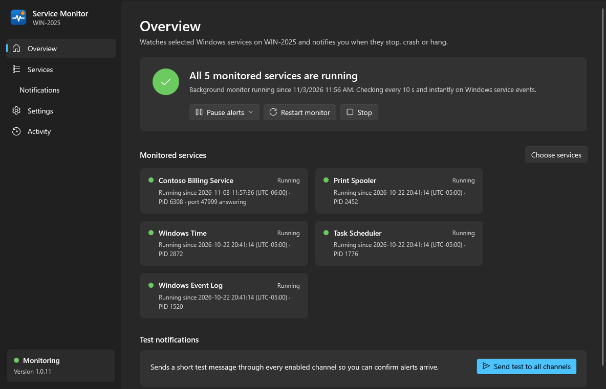
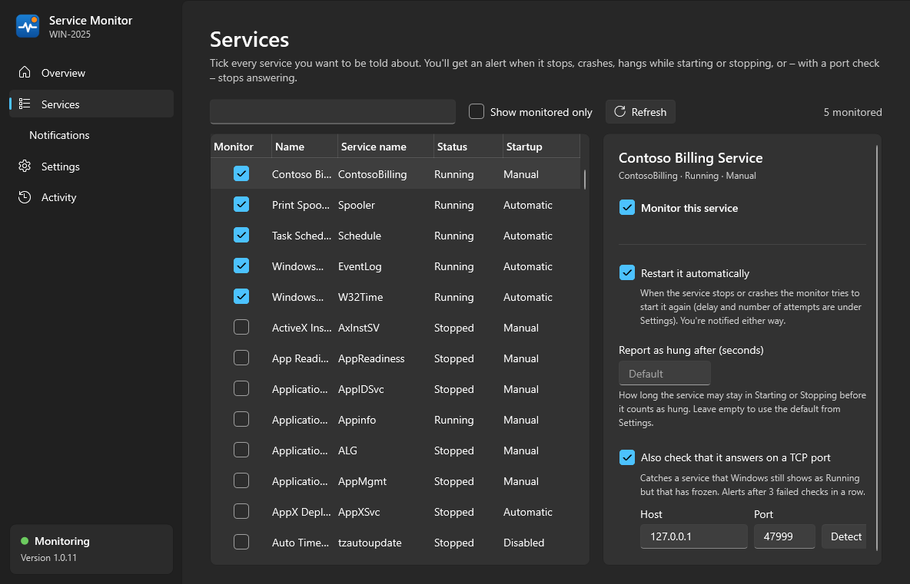
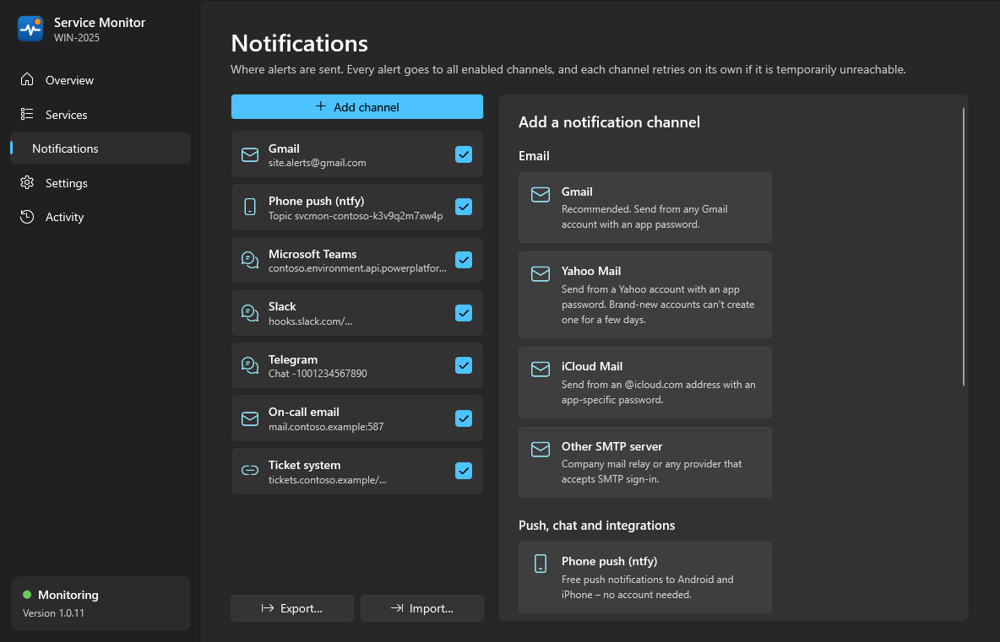
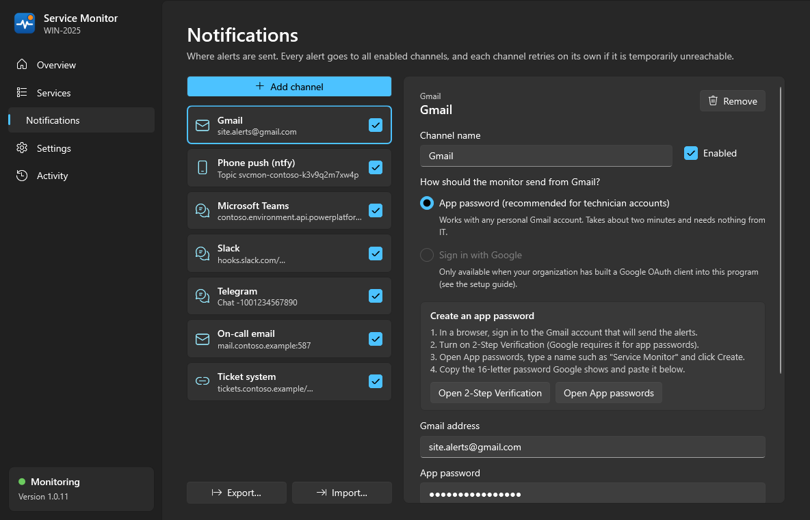
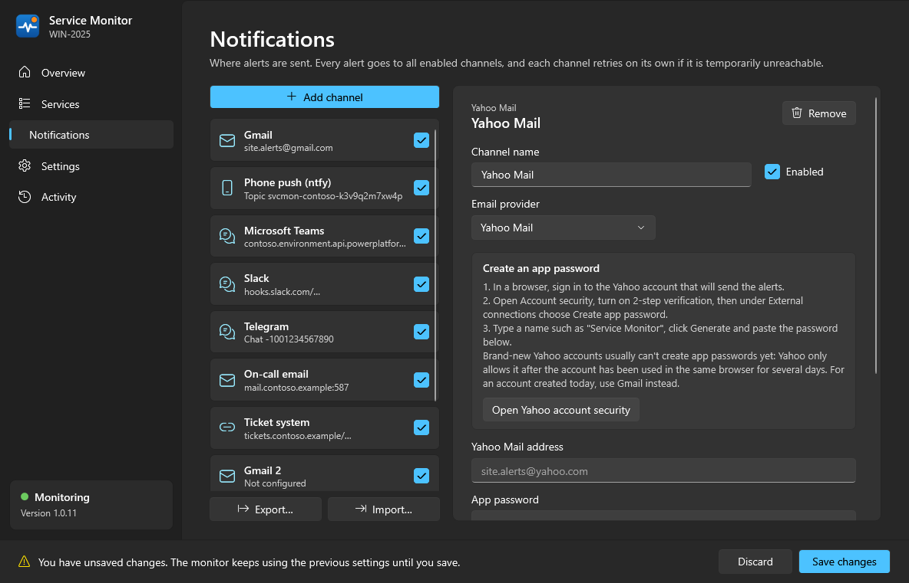
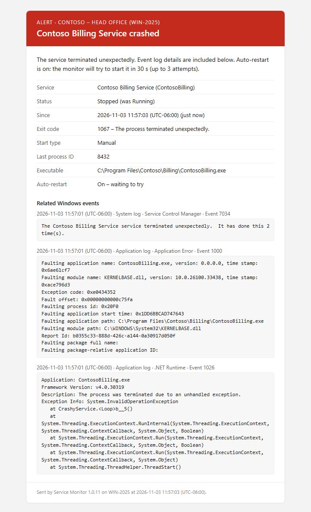

# Service Monitor – technician guide

Service Monitor watches Windows services on a customer server (for example a vendor's application
services) and tells you when one **stops, crashes, hangs or stops answering** – by email (Gmail,
Yahoo Mail, iCloud Mail or any SMTP server), phone push, Teams, Slack, Discord, Telegram or a webhook.

It comes as a setup program, `ServiceMonitor-Setup-<version>.exe`, or as the single program file
`ServiceMonitor.exe`. Nothing else needs to be installed on the server (no .NET runtime).
It runs on Windows 10 / 11 and Windows Server 2016 or newer.

---

## 1. Install on a customer server (5 minutes)

1. Run `ServiceMonitor-Setup-<version>.exe` on the server. Windows asks for administrator rights – that is
   expected. Accept the license, click **Install**, and leave **Open Service Monitor** ticked on the last
   page.
   * For a downloaded setup Windows may show *Windows protected your PC*: click **More info**, then **Run anyway**.
   * Without the setup: copy `ServiceMonitor.exe` to the server (any folder, e.g. Downloads) and double-click it.
2. The **Overview** page shows four steps. Work through them top to bottom:

   

### Step 1 – Choose the services

* Click **Choose services**, type part of the vendor's name (e.g. `contoso`) in the search box and click
  **Monitor all … matches**.
  Any other Windows service can be ticked the same way.
* Click a monitored service to see its options:
  * **Restart it automatically** – the monitor starts the service again if it stops or crashes
    (you are still notified). Leave it off if the vendor wants a person to look first.
  * **Report as hung after** – how long a service may stay *Starting* / *Stopping* before it counts as hung
    (default 120 s).
  * **Also check that it answers on a TCP port** – catches a service that Windows still shows as *Running*
    but that has frozen. Click **Detect** to fill in the port the service listens on.
    For example `ContosoWeb` → 8080.

  

### Step 2 – Choose where alerts go

Click **Add a channel**. You can add as many channels as you like; every alert goes to all of them.



#### Gmail (recommended for one-off technician accounts)

Uses a Google **app password** – nothing for IT to set up.

1. In a browser, sign in to the Gmail account that will *send* the alerts.
2. Click **Open 2-Step Verification** in the app and turn it on (Google requires it for app passwords).
3. Click **Open App passwords**, type a name such as `Service Monitor`, click **Create**.
4. Copy the 16-letter password Google shows and paste it into **App password**.
5. Enter the Gmail address, and under **Send alerts to** the addresses that should receive alerts
   (leave empty to send to the Gmail account itself).



> If your organization has built a Google OAuth client into the program (see
> `OAUTH-APP-REGISTRATION.md`), you can choose **Sign in with Google** instead and skip the app password.

#### Yahoo Mail or iCloud Mail

Work the same way as Gmail: the server settings are filled in for you, you only enter the address and an
app password. The editor shows the steps and a button that opens the right account page.

* **Yahoo:** Account security → External connections → **Create app password** (2-step verification must be on).
  Brand-new Yahoo accounts usually can't create one yet. Yahoo greys the button out until the account has been
  used in the same browser for several days, and Yahoo support can't override this. For an account created on
  the day of the install, use Gmail.
* **iCloud:** the Apple Account needs two-factor authentication and an @icloud.com address. At
  account.apple.com open **Sign-In and Security → App-Specific Passwords** and create one.



> **Why not Outlook.com / Hotmail?** Microsoft no longer lets other programs send from those accounts with a
> password or app password – only with *Sign in with Microsoft*, which needs a company app registration
> (`OAUTH-APP-REGISTRATION.md`). The Outlook.com option only appears in **Add a channel** once that
> registration is built in. Use Gmail, Yahoo or iCloud for one-off accounts.

#### Phone push (ntfy) – free, no account

1. Install the **ntfy** app on your phone (Google Play, F-Droid or App Store).
2. In Service Monitor click **Generate** to create a private topic name.
3. In the phone app tap **+** and subscribe to that topic. Everyone on call can subscribe to the same topic.

Critical alerts are sent with *urgent* priority so they can break through *Do Not Disturb* (allow this in the
ntfy app's notification settings).

#### Slack

Slack posts through a small app that you create once per workspace. It can only post to the one channel you
pick.

1. Go to **api.slack.com/apps**, sign in and click **Create an App** → **Blank app**.
2. Name it, e.g. `Service Monitor`, pick your workspace and click **Continue**.
3. On **What it can do in Slack?** search for `incoming-webhook`, click it (*Bot scopes* changes to **(1)**) and
   click **Continue**.
4. On **What it can respond to in Slack?** add nothing and click **Continue**.
5. Click **Create and Install**, pick the channel for the alerts and click **Allow**. If Slack shows
   **Request to Install** instead, a workspace admin has to approve the app first.
6. Click **Go to App Settings**, then **Incoming Webhooks** in the menu on the left. In the **Webhook URL** table,
   click **Copy** on the channel's row. The **Copy** under the sample curl request copies a whole command, not the
   URL.
7. Paste the URL (`https://hooks.slack.com/services/…`) into **Webhook URL**.

Anyone who has the URL can post to that channel, so don't share it. To alert another channel, click
**Add New Webhook** on the same page.

#### Microsoft Teams, Discord, Telegram, Webhook

Each editor shows the steps needed to get the webhook URL or bot token. The webhook channel posts a JSON
document to any URL – use it for RMM/PSA tools, Power Automate, n8n, Zapier or an on-call service.

### Step 3 – Send a test

Click **Send test** on a channel (or **Send test to all channels** on the Overview page). You can test before
saving. Check the message arrived.

### Step 4 – Install & start

Click **Save changes**, then **Install & start monitoring** on the Overview page. This:

* copies the program to `C:\Program Files\Service Monitor`,
* installs the Windows service **Service Monitor** (`ServiceMonitor`) – automatic start, and
  Windows restarts it if it ever fails,
* adds a Start menu shortcut,
* starts monitoring. The Overview page now shows the live state of every service.

After the setup the program is already there. Without the setup, you can delete the copy you downloaded.

---

## 2. What the alerts mean

Every subject starts with a tag and the site / computer, e.g.
`[ALERT] Contoso – Head Office (SERVER01): Contoso Billing Service crashed`.

| Tag | Meaning |
|---|---|
| **ALERT** – *crashed* | The service process died (Windows logged it as terminated unexpectedly). The email includes the crash details from the event log, e.g. the .NET exception. |
| **ALERT** – *stopped* / *stopped with an error* | The service stopped. If nobody stopped it on purpose, it needs attention. |
| **ALERT** – *failed to start* | Windows tried to start it and it timed out or failed. |
| **ALERT** – *is hung* | Stuck *Starting* or *Stopping* longer than the hang threshold. Usually needs to be ended in Task Manager and started again. |
| **ALERT** – *is not responding on port …* | Shows *Running* but no longer accepts connections (port check). |
| **ALERT** – *is not running* | Found stopped when monitoring began (e.g. after a reboot, once the startup grace period is over). |
| **ALERT** – *automatic restart failed* | Auto-restart is on and the monitor gave up after the configured number of attempts. |
| **STILL DOWN** | Reminder, by default every 60 minutes while the problem lasts. |
| **RESOLVED** | Running again – says how long it was down and whether the monitor, Windows or a person restarted it. |
| **WARNING** – *crashed and was restarted by Windows* | The service crashed but its own Windows recovery setting restarted it within seconds. Worth looking into. |
| **WARNING** – *Monitoring stopped* / **INFO** – *Monitoring started* | The monitor itself stopped or started – usually a server reboot. |
| **OK** | Optional daily / weekly heartbeat (Settings → Heartbeat). If it stops arriving, something is wrong with the server or the mailbox. |



---

## 3. Everyday tasks

**Planned maintenance** – Overview → **Pause alerts** (30 min / 1 h / 4 h / until tomorrow). Problems are still
tracked; anything still broken when the pause ends is reported then.

**Site name** – Settings → *Site or customer name*. It appears in every subject line.

**Update to a new version** – run the new setup. It stops the monitor, updates it and starts it again (you get
the usual *Monitoring stopped* / *started* notices). Settings and sign-ins are kept. Without the setup: run the new
`ServiceMonitor.exe`; the Overview page shows **Update installed monitor**.

> Before 1.0.8 the program was called *Windows Service Monitor*, and before 1.0.9 its service was `WinServiceMonitor`
> with settings in `C:\ProgramData\WindowsServiceMonitor`. Updating from an older version moves everything to the
> new names (`C:\Program Files\Service Monitor`, service `ServiceMonitor`, `C:\ProgramData\ServiceMonitor`) and
> removes the old folders and shortcuts. Channels and saved passwords carry over; nothing needs entering again.

**Copy channels to another server** – on the **Notifications** page click **Export…**, choose a file name and a
password (at least 8 characters). The file holds every channel with its passwords, tokens and webhook URLs,
encrypted with that password, so keep the password separate from the file. On the other server click **Import…**,
pick the file and enter the password, then **Save changes**. A channel with the same name as an existing one
replaces it. Channels that use *Sign in with Google / Microsoft* come across without the sign-in: sign in again
there. An export is also a good backup before reinstalling.

**See what happened** – the **Activity** page lists every problem, recovery, restart attempt and every
notification sent (or failed). Logs: `C:\ProgramData\ServiceMonitor\logs`.
Important events are also written to the Windows **Application** event log, source
*Service Monitor* (*Windows Service Monitor* before 1.0.8 – update RMM filters that use the old name or the old
service name `WinServiceMonitor`):

| Event ID | Meaning |
|---|---|
| 100 / 101 | Monitor started / stopping |
| 200 | Service problem detected |
| 201 | Service recovered |
| 202 | Warning (crash Windows recovered from, flood protection) |
| 203 | Automatic restart attempt |
| 301 | A notification could not be delivered |
| 302 | A notification channel needs attention (e.g. a sign-in expired) |

**Remove** – if the setup was used: Windows **Settings → Apps → Installed apps → Service Monitor →
Uninstall**. It asks whether to delete the settings too (watched services, channels and their saved passwords);
the default is to keep them. Otherwise: Settings → *Remove monitor from this computer…* (or
`ServiceMonitor.exe --uninstall`, add `--remove-data` to delete settings too).

---

## 4. Scripted / mass deployment

```bat
ServiceMonitor.exe --install
ServiceMonitor.exe --status
ServiceMonitor.exe --uninstall [--remove-data]
```

The setup also runs silently. A silent setup installs or updates the program and, on an update, restarts the
monitor; `/TASKS=""` skips the desktop shortcut. A silent uninstall keeps the settings.

```bat
ServiceMonitor-Setup-<version>.exe /VERYSILENT /SUPPRESSMSGBOXES /NORESTART
"C:\Program Files\Service Monitor\unins000.exe" /VERYSILENT /SUPPRESSMSGBOXES /NORESTART
```

After `--install` you can drop a prepared `C:\ProgramData\ServiceMonitor\config.json` in place; the
monitor picks it up within seconds. Secrets may be written in plain text in that file – the configuration app
encrypts them the next time it is opened. Example:

```json
{
  "siteName": "Contoso – Head Office",
  "services": [
    { "serviceName": "ContosoWeb", "portCheck": { "host": "127.0.0.1", "port": 8080 } },
    { "serviceName": "ContosoBilling", "autoRestart": true },
    { "serviceName": "ContosoSync" }
  ],
  "channels": [
    { "type": "gmail", "name": "Alerts", "account": "site.alerts@gmail.com",
      "appPassword": "abcdabcdabcdabcd", "recipients": "oncall@example.com" },
    { "type": "smtp", "provider": "yahoo", "name": "Yahoo backup", "username": "site.alerts@yahoo.com",
      "password": "abcdabcdabcdabcd", "recipients": "oncall@example.com" },
    { "type": "ntfy", "name": "Phone push", "topic": "svcmon-contoso-k3v9q2m7xw4p" }
  ]
}
```

With `"provider": "yahoo"` or `"icloud"` the server settings are filled in automatically. *Sign in with Google*
can't be scripted – open the app once and click **Sign in**.

---

## 5. Troubleshooting

| Problem | What to do |
|---|---|
| *Gmail did not accept the app password* | Use an **app password**, not the normal password; 2-Step Verification must be on; the account must not be in Google's Advanced Protection program. |
| *Yahoo / iCloud did not accept the password* | Use the full address and an **app password** from the account's security page, not the normal password. |
| *Microsoft no longer accepts passwords from other programs…* | Outlook.com, Hotmail and Live addresses can't send alerts with a password – use a Gmail, Yahoo or iCloud account. |
| *'…' needs attention* email | A sign-in expired or was revoked (e.g. password changed). Open the app, select the channel and **Sign in** again. The monitor refreshes sign-ins daily so they normally never expire. |
| Nothing arrives at all | Activity page – every delivery attempt is listed with the error. Failed deliveries are retried after 30 s, 2 min and 10 min. |
| Overview says *not reporting* | Click **Restart monitor**; check `C:\ProgramData\ServiceMonitor\logs`. |
